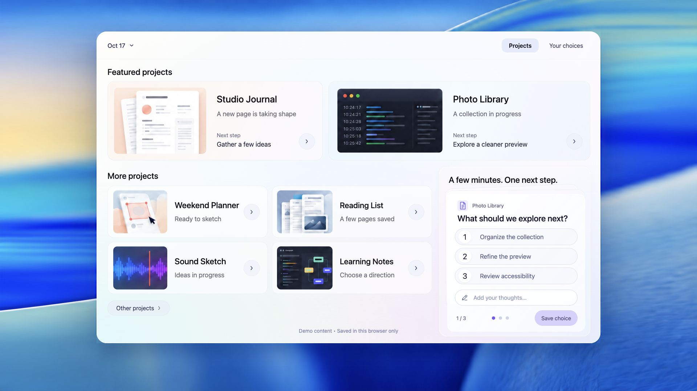
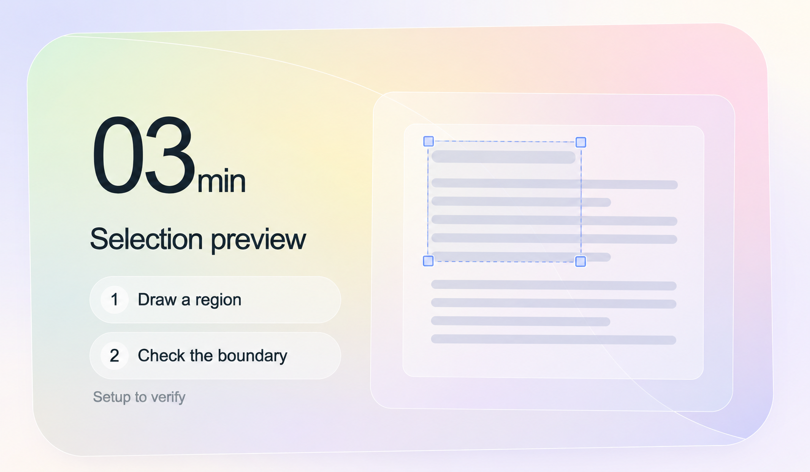

# UI Design Skills

An agent skill for designing interfaces in **three parallel directions**. For the same brief it produces one version per direction, compares them with the user and refines what the user selects.

| Direction | How its version is made | Start here |
| --- | --- | --- |
| **Linear** | Rebuilt from values measured on linear.app, with macOS and Bear proportions, in Figma or HTML | [directions/linear](directions/linear/README.md) |
| **Panel UI** | Rebuilt from inspected Panel UI components in Figma | [directions/panel-ui](directions/panel-ui/README.md) |
| **Inspiration-led** | One GPT Image version built around an expressive core, then developed into a small system | [directions/inspiration-led](directions/inspiration-led/README.md) |

## The journey

1. Fix one brief: task, content inventory, canvas and primary action
2. Produce three complete low-detail versions, one per direction, each from its own sources
3. Compare them at equal size; the user selects one or more
4. Refine each selected version against its own relationships, then audit the whole
5. Retain the result in its direction folder with a DESIGN.md, real tools, provenance and validation limits

Start with [SKILL.md](SKILL.md). Neither isolated tokens nor a polished generated image establishes a design system.

## Repository map

- [SKILL.md](SKILL.md): the three directions, the workflow and its gates
- [references/](references/multi-direction-workflow.md): methods shared by all directions
  - [Multi-direction workflow](references/multi-direction-workflow.md): one brief, three versions, comparison and selection
  - [Reference calibration](references/reference-calibration.md): measure, deconstruct, foundations, components
  - [Review and audit](references/review-and-audit.md): audit passes, screenshot review, validation gates
  - [DESIGN.md contract](references/design-contract.md): what an example records, provenance labels, maturity
  - [Agent design pitfalls](references/agent-design-pitfalls.md): feedback-derived failure signals and the delivery gate
  - [Figma execution](references/figma-execution.md): driving Figma Desktop with the figmosha CLI
  - [Code and image handoff](references/code-and-image-handoff.md): rebuilding a generated image as an editable design
  - [Design sources](references/design-sources.md): where to look and how to record sources
- [directions/](directions/linear/README.md): one folder per direction with its README, contract, sources, examples and research
- [icons/](icons/README.md): app-icon design, a separate module
- [benchmarks/](benchmarks/agent-ui/README.md): frozen agent-capability baselines

## Design dimensions

Shared by all directions:

- [Design principles](references/design-principles.md): attention, proportion, grouping, color roles, and material restraint.
- [Composition](references/composition-preservation.md): framing, scale, alignment, optical balance, and reference interpretation.
- [Grouping and hierarchy](references/grouping-and-hierarchy.md): proximity, common regions, navigation, and separators.
- [Color in context](references/color-in-context.md): foreground/background relationships, saturation, area, and contrast.
- [Typography](references/typography.md): scale, weight, supporting text, numerals, and language.
- [Shape and material](references/shape-and-material.md): silhouette, curvature, depth, glass, and detail density.

## Selected examples

Their scopes differ; open each for its method, sources and validation limits.

### Linear

**[Linear baseline](directions/linear/examples/linear-baseline/README.md)**: a Chinese page rebuilt from Linear's measured values, in HTML and as an agent-built Figma file with 77 variables, components and grids. User-approved as more professional than earlier examples; a deliberate imitation, not an original direction.

### Panel UI

No retained example yet. Its contract, components and complete page are marked to do in the [direction README](directions/panel-ui/README.md).

### Inspiration-led

**[Pastel Workspace](directions/inspiration-led/examples/translucent-ui/pastel-workspace/README.md)**: a runnable, fictional project overview. Quiet surfaces, distinct content and one decision at a time. [See how the system evolved](directions/inspiration-led/examples/translucent-ui/case-study.md).

| A focused component | An editorial composition |
| --- | --- |
|  |  |
| **[Selection](directions/inspiration-led/examples/translucent-ui/README.md)**: generated visual reference: thin surfaces, instruction pills and a generous preview. | **[Form & Field](directions/inspiration-led/examples/form-and-field/README.md)**: generated visual reference: material, lighting and typography share one scene. |

A visual study is not a tested implementation; each example states what is actually verified.

## Agent capability baselines

[Eight functional UI image studies](benchmarks/agent-ui/2026-10-20/README.md) are retained as a current-capability benchmark, not gold-standard examples. Includes production provenance, reference sources, qualified review scope and a repeatable comparison protocol. Static GPT Image outputs only; no Web validation is implied.

## Rights

The references provide decision criteria, not a universal visual template. This public repository contains no third-party screenshots; sources are linked. Reference-asset redistribution and commercial-use rights are not granted by this repository.
