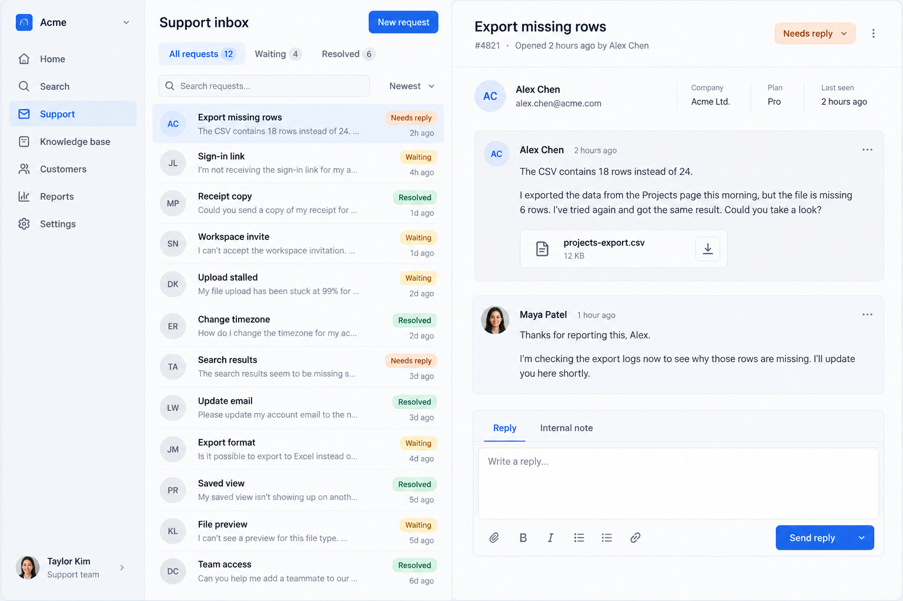
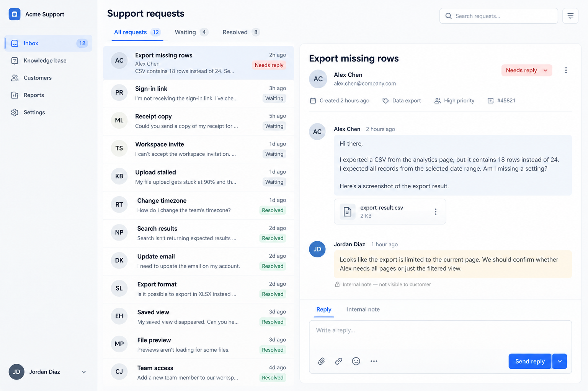
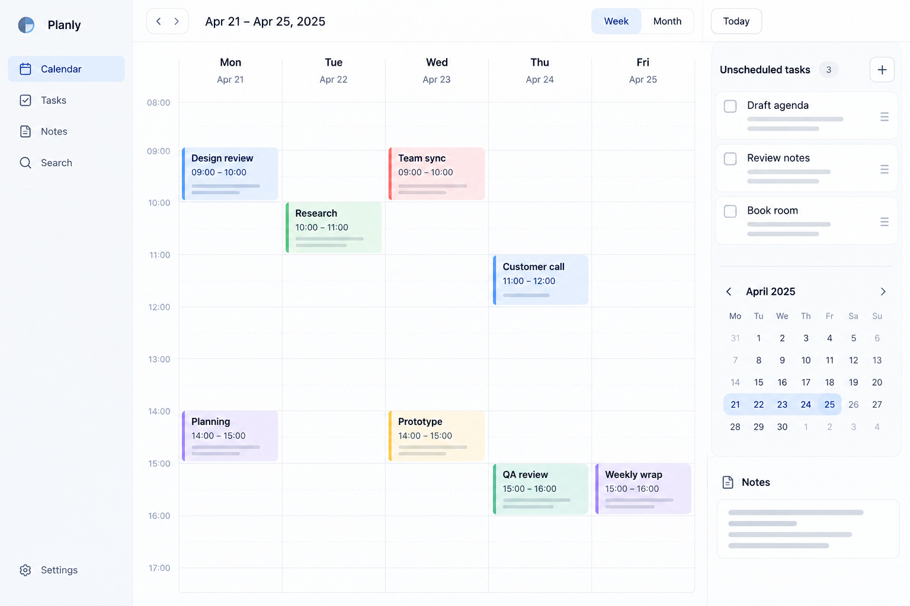
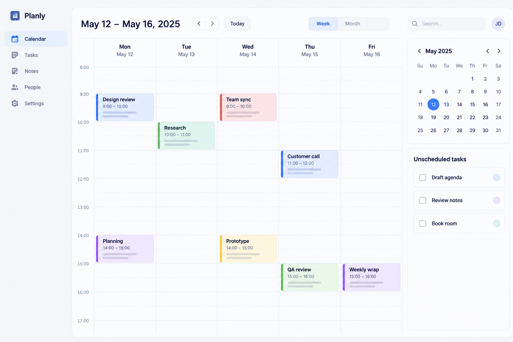
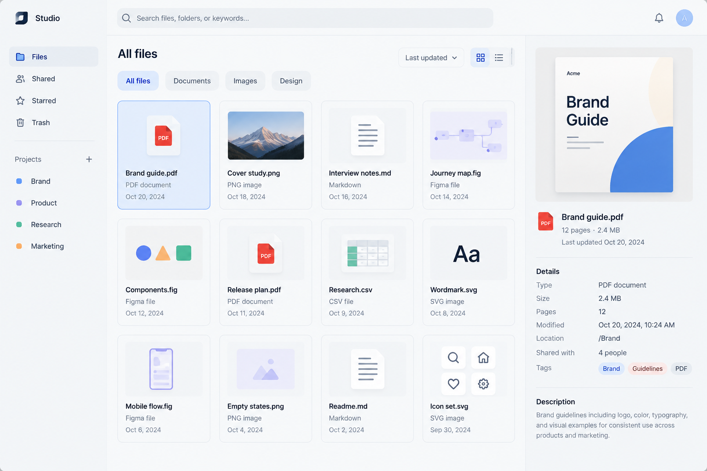
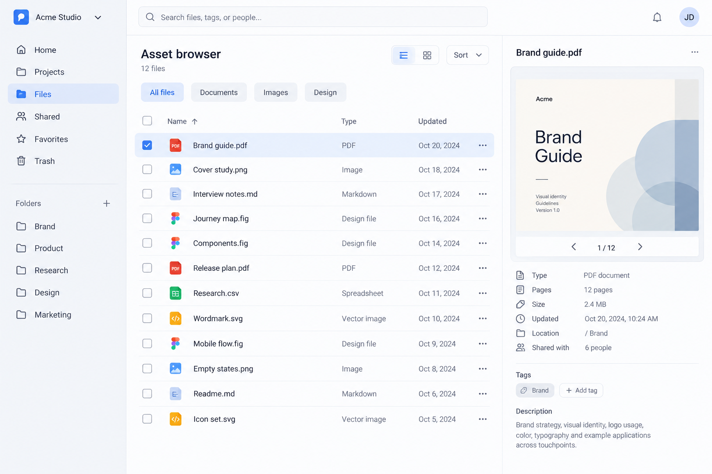
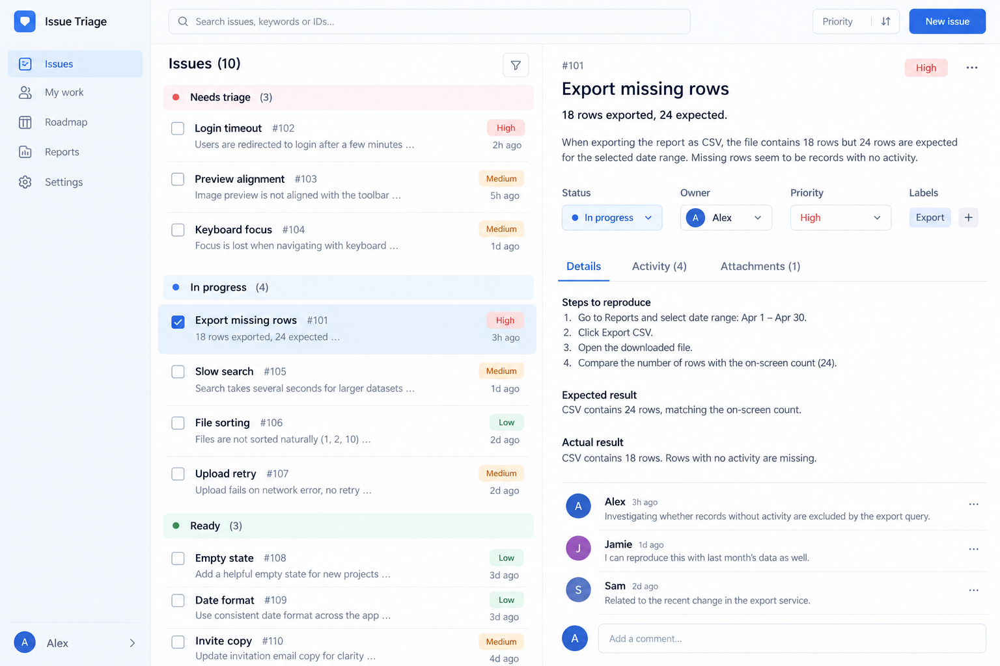
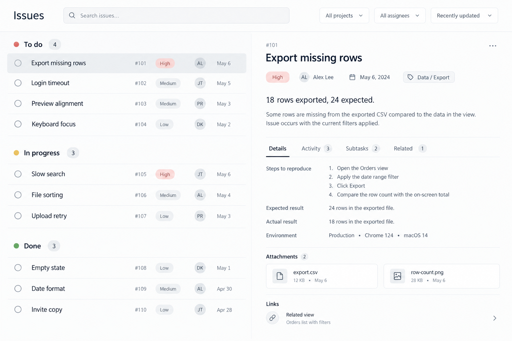

# Agent UI baseline · 2026-10-20

Eight unchanged GPT Image interface studies, retained at the user's explicit request as a **current-capability baseline**, not as exemplary design systems or verified applications

The user found no obvious issue in 01–08, but still felt the interfaces were not good enough. Earlier batch-level feedback was “substantially better and usable, with a gap to stronger interfaces.” Retention records that qualified judgment, not an excellence rating. No numerical score is inferred

## What is frozen

- The eight original 1536 × 1024 PNG files, numbered as delivered; SHA-256 values in [manifest.json](manifest.json)
- Four functional task families, two studies each; generated fictional content, not personal customer data
- [Production and source record](PROVENANCE.md), including gaps in prompt provenance
- The comparison procedure below, so later learning can be tested rather than assumed to help

These are raster concepts. Their text and controls are not editable UI. No browser, mobile, accessibility, interaction or production readiness is claimed. Parallel HTML drafts existed but were not browser-verified and are deliberately excluded. 09–10 are outside this retention request; exclusion does not mean rejection

## Gallery and repeatable task briefs

### 01 · Support inbox A

12 support requests, one selected request, a conversation and reply area

Reference: [original source](https://support.apple.com/guide/mail/welcome/mac) · Method: GPT Image, not a browser screenshot

### 02 · Support inbox B

12 support requests, one selected request, a conversation and reply area

Reference: [original source](https://support.apple.com/guide/mail/welcome/mac) · Method: GPT Image, not a browser screenshot

### 03 · Weekly schedule A

A five-day week with 8 events and 3 unscheduled tasks

Reference: [original source](https://support.apple.com/en-mide/guide/calendar/icl8c17e7f55/mac) · Method: GPT Image, not a browser screenshot

### 04 · Weekly schedule B

A five-day week with 8 events and 3 unscheduled tasks

Reference: [original source](https://support.apple.com/en-mide/guide/calendar/icl8c17e7f55/mac) · Method: GPT Image, not a browser screenshot

### 05 · Asset browser: grid

12 assets in a grid, folder navigation and a selected-file inspector

Reference: [original source](https://support.apple.com/en-ie/guide/mac-help/mchlp2605/27/mac/27) · Method: GPT Image, not a browser screenshot

### 06 · Asset browser: list

12 assets in a list, folder navigation and a selected-file inspector

Reference: [original source](https://support.apple.com/en-ie/guide/mac-help/mchlp2605/27/mac/27) · Method: GPT Image, not a browser screenshot

### 07 · Issue triage A

10 issues in 3 state groups, a selected issue and its details

Reference: [original source](https://linear.app/now/behind-the-latest-design-refresh) · Method: GPT Image, not a browser screenshot

### 08 · Issue triage B

10 issues in 3 state groups, a selected issue and its details

Reference: [original source](https://linear.app/now/behind-the-latest-design-refresh) · Method: GPT Image, not a browser screenshot

## Re-test after foundational practice

1. Preserve this baseline unchanged. Store later results as a separate dated revision with links back to these IDs
2. Pick the same task family and platform. Reuse the listed task brief and 1536 × 1024 canvas; freeze content count, text lengths, states and comparison scale in a new shared brief before making candidates. The old images vary in exact wording and dates, so the baseline supports task-matched comparison, not an exact replay of an unrecovered prompt
3. Record the new learned methods and references, which were applied, and what changed. Separate “same task, changed method” from extra content, a different brief or a different generation model
4. Compare whole-page region proportions, group structure, density rhythm, whitespace, reading order, type hierarchy and surface separation. Also inspect supporting regions; do not judge only the strongest central area
5. Use comparable renders side by side without silently enlarging the newer design. Compare raster to raster for visual progress. Evaluate a new real Web version separately with actual browser rendering and behavior checks; do not inherit functional approval from this baseline
6. Ask for user judgment: whole improvement, local improvement, relative preference, dislike, or inconclusive. No obvious defect is not the same as excellence. If the difference is too small or confounded to judge, retain “inconclusive,” not an invented win
7. Promote only independently justified reusable methods or strong examples. Do not turn every later attempt into a permanent archive or rewrite the original baseline

## Stage lesson

The intended foundational exercise was background, partition and shadow-led layout exploration. These results are more populated than that brief called for. Their qualified visual approval does not erase this process mismatch. The next foundational exercises should remain low-detail rather than use polished controls and full copy to conceal weak spatial relationships

See [agent design pitfalls](../../../references/agent-design-pitfalls.md) for the general error checks, and [the baseline index](../README.md) for scope
