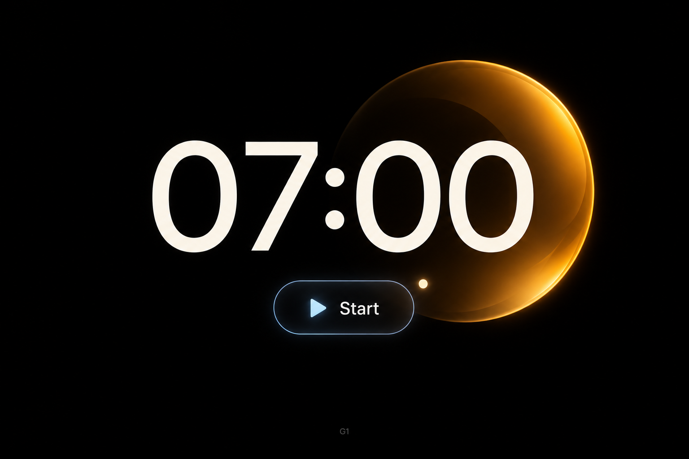

# Amber Clock

## Design thesis

An expressive amber-glass form supports a simple time display. Material cues connect the atmosphere, typography, and primary action.

## Composition

Keywords: dominant value, overlap, asymmetric mass, quiet field.

- A large warm-white time value leads the composition.
- The amber disc sits behind the right side of the numerals; overlap links type and image.
- Broad black space balances the right-heavy object.
- The compact action remains below the reading focus.

## Color and attention

Keywords: warm atmosphere, cool accent, localized brightness.

- Amber carries atmosphere; warm white carries information.
- The disc is large, but most of its surface is dark. Narrow bright edges contain its visual weight.
- A small icy-blue accent distinguishes the action without dividing the whole canvas into competing color regions.

## Material relationships

Keywords: shared curvature, luminous edge, smooth surface, reflected warmth.

- The disc and button share restrained transparent-looking edge light.
- Rounded numerals, the disc, and the capsule form a related shape family at different scales.
- Clean numeral interiors contrast with the richer glass rendering.
- Evaluate the combined type, button, and glass, not the glass object alone.

## Application

Useful for a focused timer, ambient clock, or a single-action media concept. Confirm whether the value represents time or duration in the actual product. This sparse treatment is not a default for dense information screens.

## Implementation

- Rebuild the time and button as editable text and a real control.
- Keep the glass artwork as a separate asset with explicit crop and scale.
- Check changing digits, button states, narrow sizes, and contrast against the artwork.
- Omit the study identifier G1 from production UI.

## Provenance and limits

Generated with GPT Image. The original verbatim prompt was not recovered; surviving concept notes describe the black field, warm-white time, amber disc, and small icy-blue action. This analysis is not an original prompt or proof that any wording caused the result.

Static visual reference only. Exact font, color values, material physics, responsive behavior, and accessibility are not validated. See [asset metadata](asset.json).
