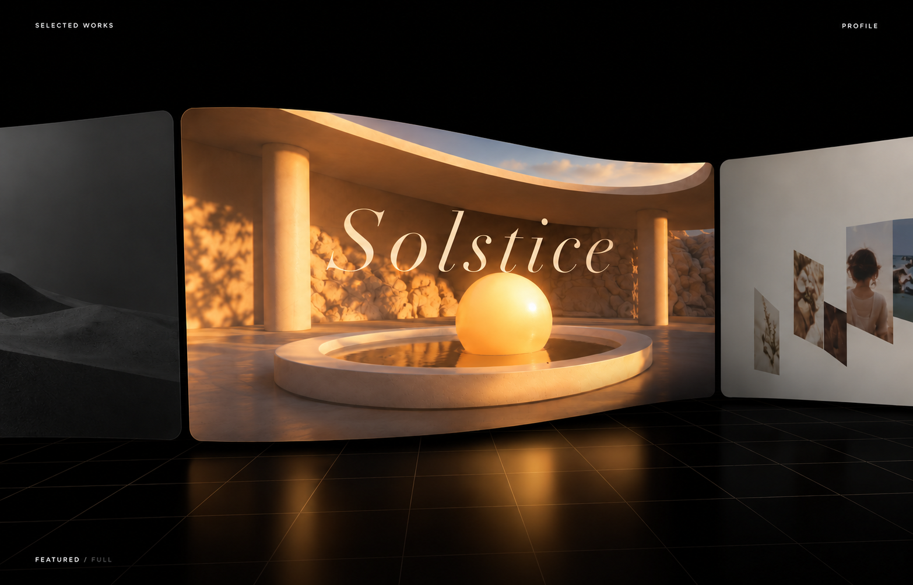

# Curved Gallery

## Design dimensions

- Framing: one complete central image, two cropped neighbors.
- Perspective: left-near/right-far asymmetric curvature.
- Attention: warm artwork surrounded by a quiet dark field.
- Scale: very small peripheral white labels against a large visual subject.
- Depth: restrained reflection rather than a bright mirror.

## Use

A visual reference for artwork focus, image browsing, or a slide-viewer concept. Preserve the spatial relationships before changing artwork or palette.

## Construction

See [visual specification](recipe.json) for relationships, key parameters, and implementation limits. The image was generated as a study; it is not a screenshot of the source site or a functional component.

## Source and use limits

Reference: http://jesperlandberg.com

Static visual only. Interaction, responsive behavior, and accessibility require separate implementation and validation. Source assets remain with their rights holders; commercial reuse clearance has not been established.
