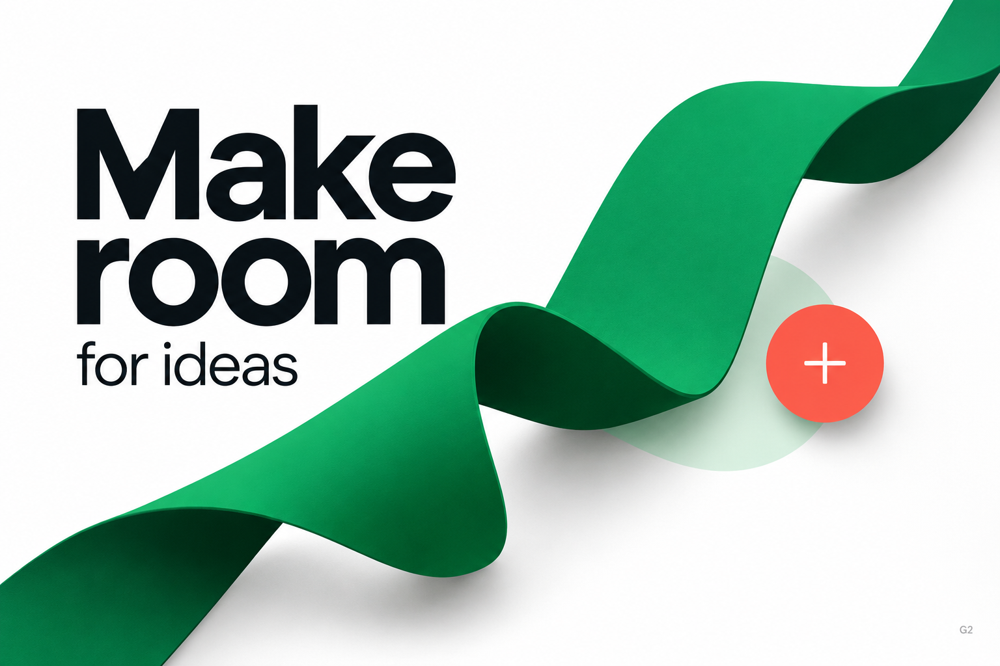

# Green Ribbon

## Design thesis

A soft folded ribbon introduces movement and tactile depth around a stable block of typography. A small contrasting action creates a localized counterpoint.

## Composition

Keywords: stable anchor, diagonal continuity, crop, counterweight.

- The bold two-line heading anchors the upper-left region.
- The ribbon travels diagonally across the canvas and exits its edges, suggesting continuation.
- The smaller supporting line keeps the text hierarchy clear.
- The circular action occupies a compact area to the right rather than repeating the headline's scale.

## Material and typography

Keywords: soft curve, matte surface, fold, contact shadow.

- Broad smooth green surfaces carry gentle tonal variation.
- Darker reverse faces and soft shadows explain the folds without dense microtexture.
- The material gives the surrounding type a tactile spatial context while the lettering stays simple and crisp.
- Preserve the relationship between the stable text block and the flowing ribbon; a decorative object alone does not supply hierarchy.

## Color roles

Keywords: dominant green, neutral field, small warm accent.

- White provides breathing room; near-black carries the message.
- Green dominates the artwork; a restrained pale-green region supports the action area.
- Coral creates a compact warm counterpoint.
- Preserve the accent's subordinate area rather than recoloring multiple controls in coral.

## Application

Useful for a creative-workspace introduction, idea-capture entry point, or an editorial campaign fragment. If the plus symbol is interactive, connect it to a clear creation action and label it accessibly.

## Implementation

- Keep text and the action editable; treat the ribbon as an independent artwork asset.
- Preserve the crop and text clearance when adapting to a narrow screen.
- Avoid putting important copy across dark folds or shadow-heavy areas.
- Omit the study identifier G2 from production UI.

## Provenance and limits

Generated with GPT Image. The original verbatim prompt was not recovered; surviving concept notes describe the white field, black display type, emerald ribbon, darker reverse face, pale mint region, and coral action. This analysis is not an original prompt or a controlled prompting experiment.

Static visual reference only. Exact font, color values, responsive behavior, interaction, and accessibility are not validated. See [asset metadata](asset.json).
