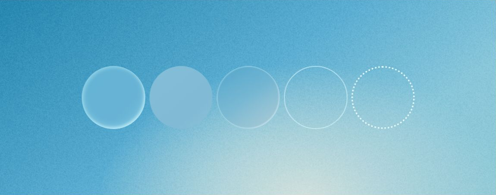
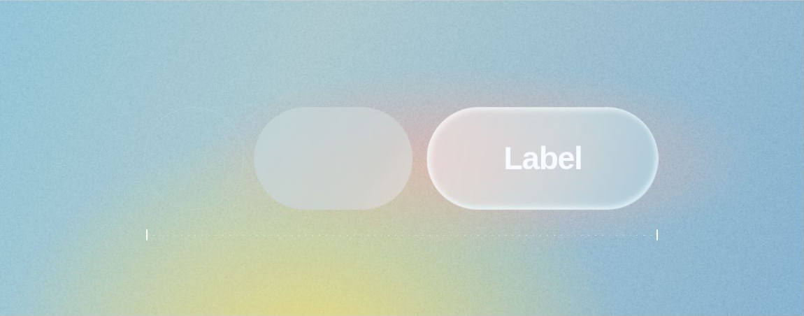

# Material and Attention

Two related studies: five equal circles with different surface treatments, followed by a progression from a quiet outline to a filled capsule and a luminous labeled capsule.

## Browser previews

Cropped screenshots of the actual HTML/CSS in cloud Chrome, captured 2026-10-13. These are not generated concept images.

## Why the composition works

- **Stable rhythm:** Equal circle dimensions, a shared centerline and controlled gaps give different material cues a common frame.
- **Selective complexity:** Richness lives in the backing field, edge light and transparency; the geometry remains simple.
- **Related color, distinct surfaces:** A blue family connects the subjects to the field without requiring every face and edge to have the same value.
- **Attention through several cues:** In the second study, area, fill, edge light and text work together. It is not a controlled proof that material alone causes emphasis.

The second study uses a larger labeled capsule as its destination; the first compares treatments without assigning a functional selected state. They share a material vocabulary, not the same interaction meaning.

## Implementation

Open [index.html](index.html) in a browser. CSS creates shapes, gradients, translucent faces, inner highlights and borders. Canvas supplies deterministic background grain only; no reference screenshot is embedded.

Starting relationships, estimated from the reference:
- Wide canvas: 1914:752.
- Circle diameter: about 12.75% of canvas width; centers share one horizontal line.
- Attention shapes: similar height, increasing width; a thin axis reinforces the progression.
- Preserve a calm face before increasing rim light or texture.

These are reproduction parameters for this study, not universal UI tokens. CSS blur and compositing approximate appearance without physical refraction.

## Use and limits

Useful for comparing material cues or explaining emphasis in a component study. A decorative heading illustration is not itself a usable input/control system. Small-screen scaling preserves the comparison canvas but does not validate mobile component usability.

Appearance was approved by the commissioning user on 2026-10-13. Desktop rendering was inspected in cloud Chrome at a 1180 × 757 viewport; no horizontal page overflow was observed. The grain toggle was tested off and on, including its pressed state and visible canvas state. Mobile adaptation and a complete accessibility audit remain unverified. Static parsing and script syntax checks also passed.

## Source and related guidance

Independent code study after [Adobe Spectrum Colors](https://spectrum.adobe.com/page/using-color/) and [Attention hierarchy](https://spectrum.adobe.com/foundations/attention-hierarchy), accessed 2026-10-13; source publication dates unverified. Adobe artwork and brand fonts are not bundled. No claim of official component or token fidelity.

Read [shape and material](../../../../references/shape-and-material.md), [composition](../../../../references/composition-preservation.md) and [code and image handoff](../../../../references/code-and-image-handoff.md).
