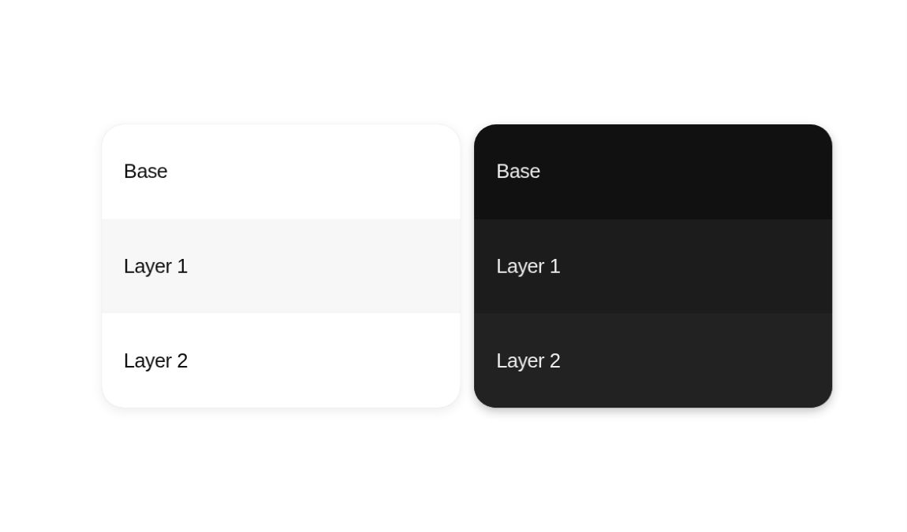

# Neutral Surface Layers

A light and dark panel share the same three-row geometry, text placement and outer silhouette. Local neutral-value differences organize the regions.

## Browser preview

Cropped screenshot of the actual HTML/CSS in cloud Chrome, captured 2026-10-13. This is not a generated concept image.

## Why the composition works

- **Shared geometry reduces noise:** Comparable widths, heights, radii and text positions make the surfaces easy to read as one system.
- **Grouping without decoration:** A shared enclosure and restrained value changes establish regions without separate cards for every row.
- **Typography remains stable:** Text stays simple and consistently placed; it does not need to inherit a decorative hue from each surface.
- **Depth is concentrated:** Soft outer shadows anchor each panel. Strong internal outlines are unnecessary in this specific composition.

Light and dark themes do not use identical lightness sequences. Here the light panel alternates white, light neutral and white; the dark panel uses successively lighter dark neutrals. This is an observed example, not a general elevation algorithm.

## Implementation

Open [index.html](index.html). CSS grid creates equal rows; fill colors, clipping and restrained shadows supply the structure. Text is real HTML. No source artwork, external assets or runtime dependency is included.

Approximate starting parameters:
- Canvas ratio: 998:587.
- Each panel: about 39.5% of canvas width and 53.3% of height.
- Row heights: equal; text inset about 2.4% of canvas width.
- Neutral faces: light #fff / #f7f7f7 / #fff; dark #111 / #1c1c1c / #222.
- The paired study scales as an illustration. A production panel needs its own readable responsive layout.

Values are reconstruction choices, not verified Adobe design tokens or font measurements.

## Use and validation

Useful for section grouping, theme comparison and surface-role studies. Re-evaluate real content density, text contrast and actionable states before using the pattern in a product.

Appearance was approved by the commissioning user on 2026-10-13. Desktop rendering was inspected in cloud Chrome at a 1180 × 757 viewport; no horizontal page overflow was observed. Mobile adaptation and a complete accessibility audit remain unverified. This study has no business interaction.

## Source and related guidance

Independent code study after [Adobe Spectrum Colors](https://spectrum.adobe.com/page/using-color/), accessed 2026-10-13; source publication date unverified. No original image or proprietary font is bundled.

Read [grouping and hierarchy](../../../../references/grouping-and-hierarchy.md) and [color in context](../../../../references/color-in-context.md).
