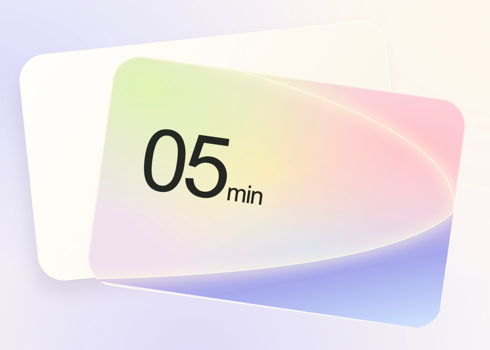
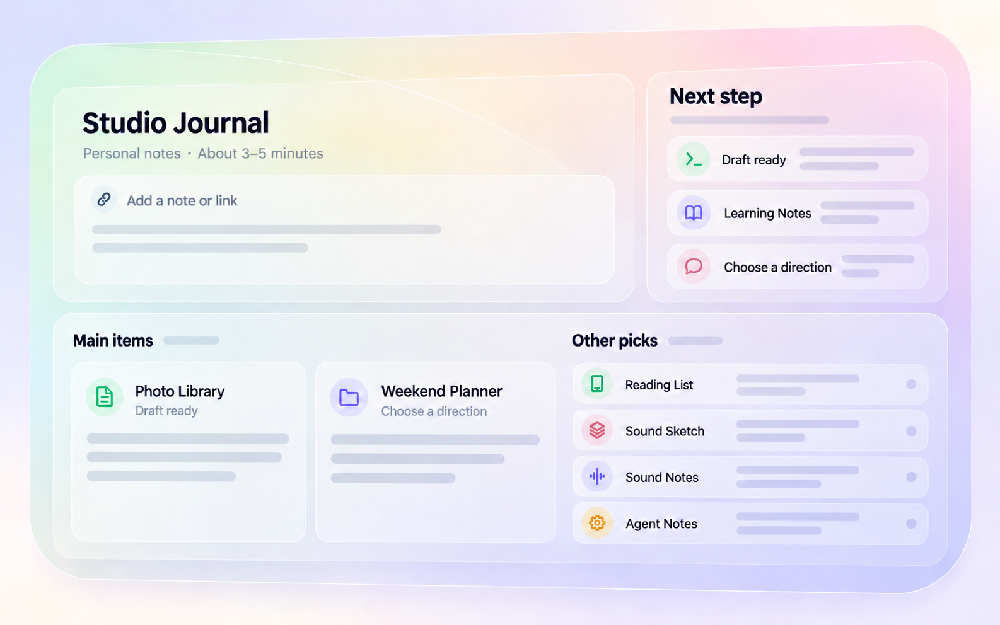

# From one beautiful detail to a small UI system

A visual case study · 05min → Selection → a usable workspace

## The method we would use next time

**Find the core → expand one step → compare and explain → expand again.**

Explore the core with GPT Image. At each scale, keep the relationships that make it beautiful; redesign the surrounding space for the new information. Review the whole before moving on.

## 1. A feeling worth keeping

**Keep:** almost weightless surfaces, soft multicolor light, delicate edges and a little spatial tension.

## 2. Give that feeling a useful job

**Keep:** the readable instruction pills, generous preview and precise selection frame. Material now supports a task. The controls and their spacing matter as much as the glass.

## 3. The jump to a whole page failed

**Change:** too many equally expressive cards. Repeating a beautiful component did not create a beautiful page. The next step needed hierarchy, density and quieter supporting regions.

Privacy-safe reconstruction of a rejected direction; not an original screenshot.

## 4. Learn the relationships from Apple

*Reference (not reproduced here; rights remain with Apple):* Apple's macOS Tahoe 26 announcement image shows the Music app on a MacBook Pro. A saturated blue wallpaper fills the screen. The app window is a calm, light, blurred surface: a translucent sidebar with small coloured icons sits beside a near-white content area. Album artwork carries almost all of the colour. A floating glass playback bar, translucent widgets and the Dock add selective glass controls on top.

**Borrow:** a rich background, a calm blurred app surface, distinct content surfaces and selective glass controls. Color and material have different jobs. Avoid washing everything in one theme color.

[Original Apple Newsroom image · June 9, 2025](https://www.apple.com/uk/newsroom/2025/06/macos-tahoe-26-makes-the-mac-more-capable-productive-and-intelligent-than-ever/)

## 5. Bring it back to a working page

**Result:** a quiet reading surface, compact project overview and one decision at a time. The question stack advances one card per gesture; choices stay in a compact dialog.

**The lesson:** preserve the feeling, reconsider its scale. Glass can lead a small composition and become a supporting material on a dense page.

Images 1–2 are generated studies; image 3 is an anonymized reconstruction; section 4 describes an Apple image by link only; the final image is an actual Web screenshot. This is a small reference system with local demo state, not a connected product. Physical mobile, Safari and real trackpad behavior still need validation.
