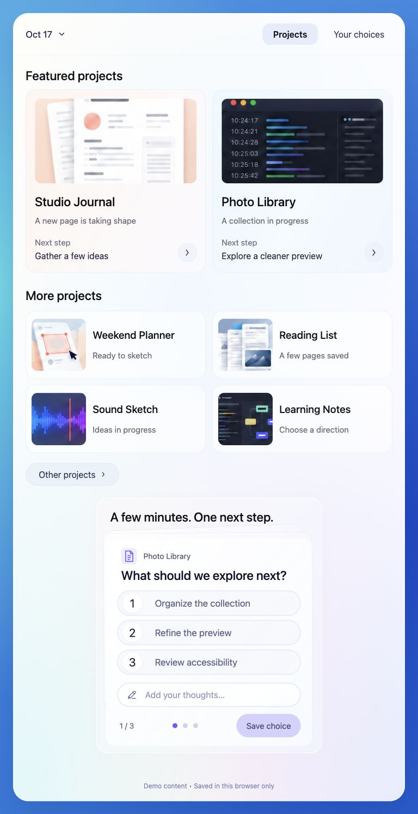
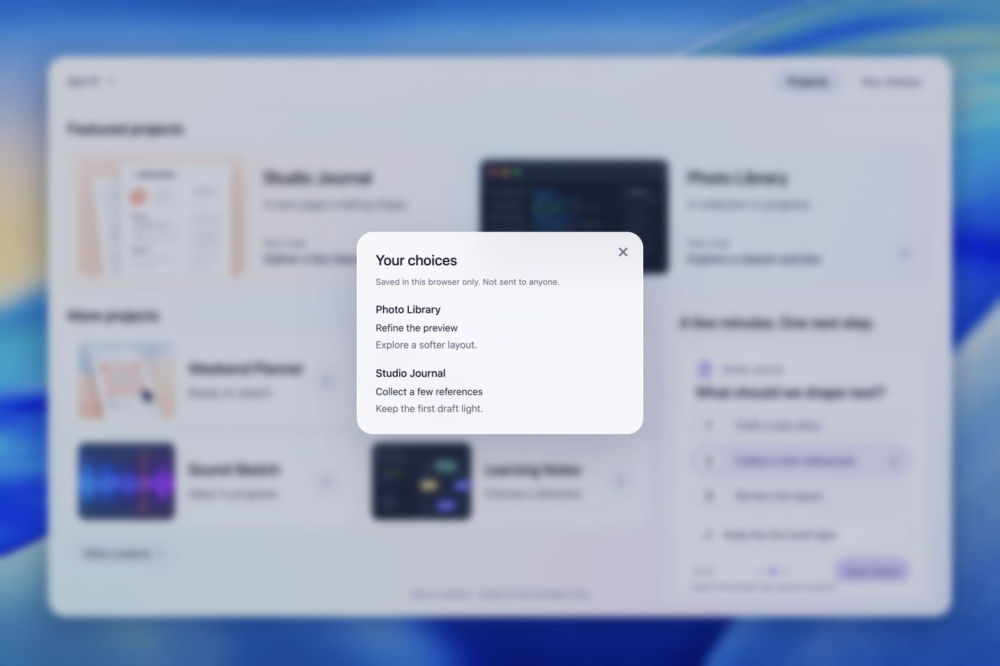

# Pastel Workspace — page-level example

A runnable, fictional project overview within the [Translucent UI example system](../README.md). The owner approved the underlying Web composition for practical use on 2026-10-17. This edition uses fictional English content and incorporates the requested navigation simplification. New screen sizes are demonstrated, not universally validated.

This page inherits the [family design contract](../DESIGN.md); its concrete implementation and validation below remain authoritative for this page.

## What carries the beauty

Keywords: quiet luminous surface, content color, unequal density, thin contours, readable ink.

The calm, nearly white app surface contains broad, low-contrast color and light variation. The varied outer wallpaper and project illustrations carry stronger color. Dark text anchors the information. Transparency is distributed by role rather than applied equally to every region.

## Page relationships

- Two featured projects establish the first scan. Their illustrations and next-step copy share a horizontal relationship on desktop.
- Four smaller project rows form a denser secondary group. Their reduced scale communicates priority without making supporting text faint.
- One question occupies the action area, with three comparable numbered options and a free-text alternative. Rear sheets suggest more questions without displaying several competing forms.
- Short saved selections belong in a compact dialog over the overview. A sparse result does not need a separate full-page canvas.
- Small borders and shadows explain grouping. Material detail stays quieter than labels, selected state and input focus.
- At narrow widths, sections reflow in reading order. Preserve text size and internal padding instead of shrinking the desktop canvas wholesale.

## Reproduce and adapt

**Input:** a small set of projects with explicit priorities, short statuses, bounded next steps, and a few questions with three options each.

**Method:** retain the quiet outer-to-inner hierarchy; choose content illustrations; establish featured/secondary/action density; render live text and controls; add broad surface gradients and restrained contours; inspect both the central content and auxiliary toolbar, footer, dialog and focus states.

**Output:** an editable HTML/CSS/JavaScript page with local demonstration state. Start from [index.html](index.html); serve this directory with a static HTTP server. No build step or package dependency is required.

**Acceptance:** check the complete composition at its intended viewport, option/text wrapping, keyboard focus, saved-versus-draft state, one-card gesture limits, interrupted settling, dialog dismissal and reduced motion. A technically passing test is not visual approval at every size.

**Boundary:** suitable for a modest overview and short decisions. Dense tables, long reading, many concurrent actions and real workflow handoff require new layout and integration work. Do not use its palette as a universal template.

## Implementation and behavior

- CSS grid provides layout. CSS gradients, blur, fine borders and shadows provide the surfaces; separate raster artwork supplies the wallpaper and illustrations.
- All meaningful labels, options and inputs are live HTML. The page is not a flattened screenshot. It does not require a GPU shader.
- Adjacent question content travels with the pointer and settles through a spring. A gesture advances at most one adjacent card; small drags return to the current card.
- Wheel momentum is grouped heuristically because browsers do not expose a universal gesture-end signal. Physical trackpad acceptance remains a separate check.
- Drafts are stored only in this browser. Confirmed choices are snapshots for the current tab session and local day; they are not sent to an owner or service. Old unrelated records are neither read nor deleted.

## Evidence and provenance

The retained Web design developed from image-led material exploration and iterative HTML/CSS reconstruction. Reference screenshots guided review; these repository screenshots are clean renders of the fictional demo, not the user's feedback captures. The two [wide and narrow concept references](concepts/README.md) were separately approved on 2026-10-17. They are generated design references, not implemented screenshots; their exact controls and composition differ slightly from the runnable example.

Project names, statuses, dates and notes are illustrative. Decorative thumbnails are not evidence of real product interfaces. No personal project records, conversation screenshots, credentials or local browser storage are included.

See [validation and asset notes](VALIDATION.md) for the tested scope and remaining limits. System fonts are requested by name and are not bundled. No third-party brand or font rights are granted by this example.
