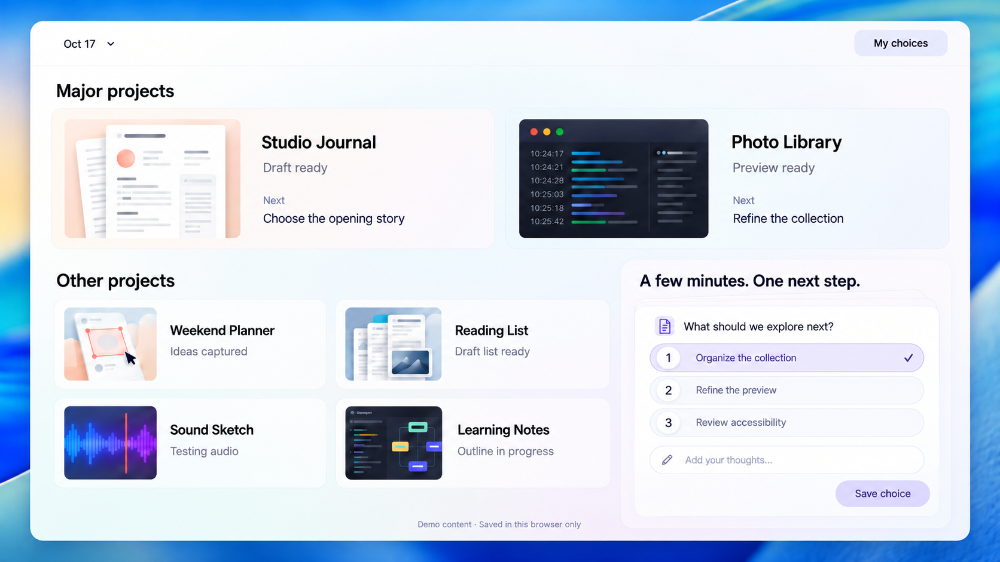
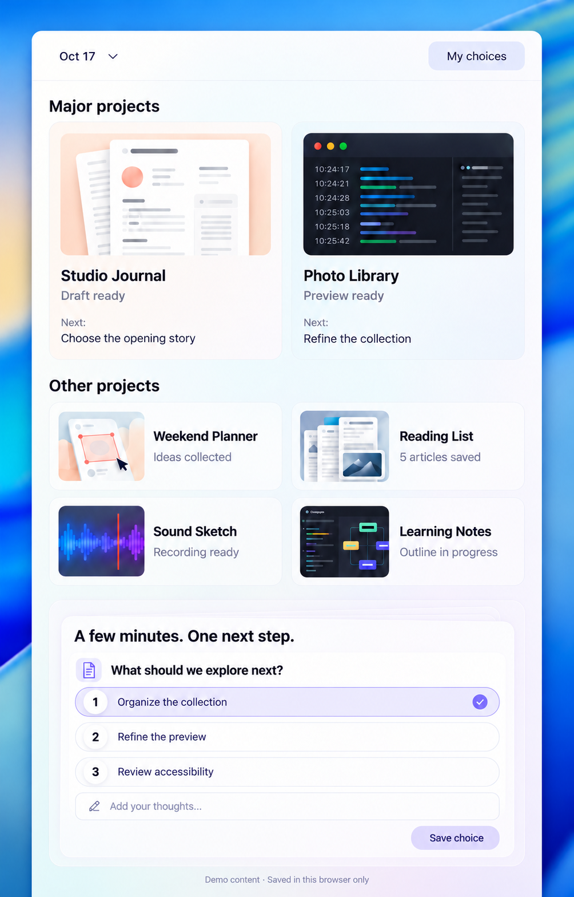

# Approved wide and narrow concepts

Two GPT Image references approved on 2026-10-17, derived from the accepted Web composition and rewritten with fictional English content. They preserve the quiet pale app surface, content-led color, thin contours and numbered options while exploring screen-width adaptation.

## Wide

Two featured cards span the top. A denser project group sits beside a focused question stack. Stronger color stays in artwork and the outer backdrop.

## Narrow

Featured artwork moves above copy; secondary projects retain two columns; the question stack moves below. The idea is reflow rather than reducing the entire desktop composition.

## Reproduction and boundary

Use the approved Web screenshot as the layout/material reference, replace all real project content with a coherent fictional brief, and request one canvas per viewport. Preserve thin surfaces, dark readable type, restrained selection, and the numbered-circle pill construction. Inspect the small controls after generation: the first narrow attempt incorrectly substituted radio circles and a full-width button; the retained version restores numbered pills and a compact save action.

The generated files are static reference images. They do not prove interaction, responsive breakpoints, data persistence or pixel parity with the [runnable example](../README.md). Concept approval does not automatically approve every implementation difference.

OxiPNG was tried. It removed the embedded C2PA chunk; forcing preservation caused optimization to abort. These originals therefore retain their provenance metadata as an explicit compression exception. Their RGBA-preserving optimized trials were not substituted. Do not strip provenance silently merely to reduce file size.
