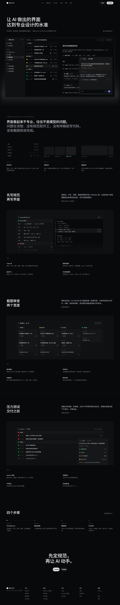

# Linear Baseline: Reference-First Calibration

A Chinese landing page for an AI UI workflow, rebuilt on values measured from linear.app, in two routes: hand-written HTML and an agent-built Figma file with variables, components and grids. **Calibration baseline:** on 2026-10-20 the user judged the Figma result more professional than the previous examples in this repository. It deliberately imitates Linear's system. It is not an original visual direction and should not be reused as a brand.

[Figma file](https://www.figma.com/design/cytw6jxvr7NDe0K406hGME) · [DESIGN.md](DESIGN.md) · [Rules](rules.md) · [Provenance](provenance.md) · [Method](../../references/reference-first-workflow.md) · [Process notes](../../research/2026-10-20-reference-first/README.md)

| Figma desktop 1440 (resized to 960) | Figma mobile 390 |
| --- | --- |
|  |  |

Foundations and components: [figma-foundations.jpg](screenshots/figma-foundations.jpg) · [figma-components.jpg](screenshots/figma-components.jpg). HTML route: [web-desktop.jpg](screenshots/web-desktop.jpg) · [web-mobile.jpg](screenshots/web-mobile.jpg). All images are our own renders. No Linear or Apple screenshot is included; see [provenance](provenance.md) for source links.

## Open

- **HTML:** open `index.html` in a browser. It loads Inter, Noto Sans SC and JetBrains Mono from Google Fonts, so it needs network access.
- **Figma:** the pages are Foundations, Components and Screens. Access depends on the file owner's sharing settings.

## What the two routes contain

| | HTML (`index.html`) | Figma |
| --- | --- | --- |
| Foundations | CSS custom properties (see DESIGN.md) | 77 variables in 5 collections, 10 text styles, 2 effect styles |
| Components | Inline HTML/CSS | Button, Sidebar row, List row, Toolbar group, Input, plus Icon/Status/Avatar/Tag, with variants and properties |
| Screens | 1440 and 390 full pages, 3 review rounds | 1440 and 390 frames on grids, 2 review rounds; 697/697 solid fills bound to variables |
| Display type | 64 / 48 (Linear values, CJK line height) | 56 / 40 (after review: 64 looked heavy in CJK) |

## Limits

Static marketing page only: no interaction, no light theme, no accessibility audit. The product UI inside the page is a realistic mock with fictional data. The Figma file uses one mode per collection (Starter plan). Gradients (hero glow, fades) and the focus ring use raw values. The mobile export is 1x.
