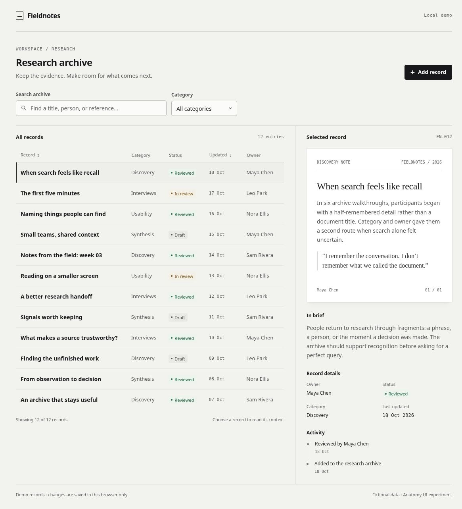

# Anatomy UI / Fieldnotes

An isolated, experimental small UI system and working research archive, based on selected Anatomy source facts and the UI experiment brief. **Ready for visual review, not yet visually approved.** No GPT Image, external assets, packages, fonts or network APIs are needed.



[Experimental design contract](DESIGN.md) · [Source transfer map](source-map.md) · [Rules](rules.md) · [Attribution](provenance.md) · [Validation](VALIDATION.md)

## Open and reproduce

```sh
cd examples/anatomy-ui
python3 tests/serve.py
```

Open `http://127.0.0.1:8767/example.html`. This server binds only to localhost and serves this directory. For consistent local saving use the localhost URL. The browser saves only this demo’s records, under `anatomy-ui.fieldnotes.v1`.

```sh
node --test tests/model.test.cjs
```

Open `http://127.0.0.1:8767/tests/browser.html?run=1` to rerun the browser checks. The harness injects disposable in-memory storage into the iframe, leaving demo storage unchanged. With the provided server, it writes the completed result to `tests/browser-results.json`; otherwise use Download JSON report. `?width=390`, `?width=768` and `?width=1440` show exact iframe widths. `?manual=dialog&width=390` and `?manual=keyboard` prepare native-key checks.

## What is usable

- Search title/person/reference, combine category, sort title/date, select a row and read a matching preview, summary, metadata and activity.
- Add a record with field validation; cancel or native Escape; return focus to the opener. Repeated submission is guarded.
- Saved/failed receipts reflect storage results. A failed write keeps the session’s record and exposes Retry saving; corrupt/unavailable storage produces an explicit fallback notice.
- Desktop table/detail split, stacked tablet layout and mobile record rows; no images of text. All names and research content are fictional.

`tokens.css` contains roles; `components.css` contains toolbar, field, table, badge, document, metadata, timeline, button, dialog and empty-state styling. `model.js` provides reusable guarded numerical/state/storage utilities. `data.js` and `app.js` implement this example. [rules.md](rules.md) records input → method → output → acceptance → limits; [provenance.md](provenance.md) distinguishes upstream facts, copied code, adapted ideas and new choices. [VALIDATION.md](VALIDATION.md) gives evidence and remaining checks.

## Scope and license

Spacing 4/8/12/16/24/32, type 14/24, row 52, control 38, radius 4, 64/36 composition and breakpoints are **new experimental UI choices**, not Anatomy standards. The isometric camera, illustration occupancy and physical-part density are not UI grid rules.

Source inspected: Anatomy `e9488296a44211c42701ff71705b7901470ec78f`; target inspected: ui-design-skills `d80ed08516e0a38b351385b2b452023a425b9e5b`. The full audit inventory is intentionally excluded from this minimal handoff. Preserve [LICENSE.anatomy](LICENSE.anatomy), including `Copyright (c) 2026 Ryan`, when distributing reused portions. No blanket license is inferred for the target repository, which had no root license at inspection.

This is a browser-local data demonstration with at most 500 validated records, no backend/authentication/multi-user conflict handling, no dark theme and no production accessibility certification. User aesthetic review and broader-browser/assistive-technology validation remain separate. This example is collected as an experiment; inclusion is not user approval of its visual quality.
