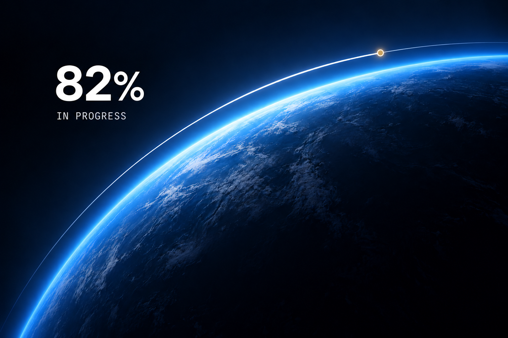

# 轨道进度加载视觉

## 认可与用途

用户明确认可此效果并要求收录。2026-10-12入库。作为进度加载的视觉参考。

## 为什么值得保留

暗场、冷蓝弧光与白色大数字建立主次；小尺寸近白色等宽状态字不抢数字；一个暖色点提供局部对比，轨道与地球曲面相呼应。

这些解释是基于用户认可结果的设计分析，尚非跨场景验证的理论。

## 制作方法

参考原作，先保留构图及关键比例，再用GPT Image生成或局部编辑。完整提示和哈希见[制作记录](recipe.json)。原始参考图未在此复制；没有参考输入，仅凭提示不能保证重现完全相同效果。

## 来源与边界

原作：https://edolus.com/

仅静态概念；82%数值和弧长未校准，真实进度、加载运动、错误状态及可读性未完整验证。生成编辑造成少量地表纹理漂移。

本图是学习参考后的生成效果，不是原站截图，也不是原作者出品。来源资产版权仍属于各权利人；未确认商业素材许可。
