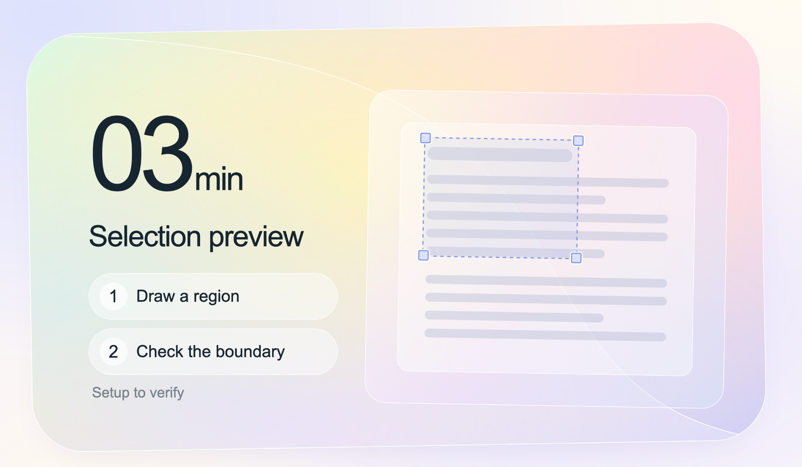
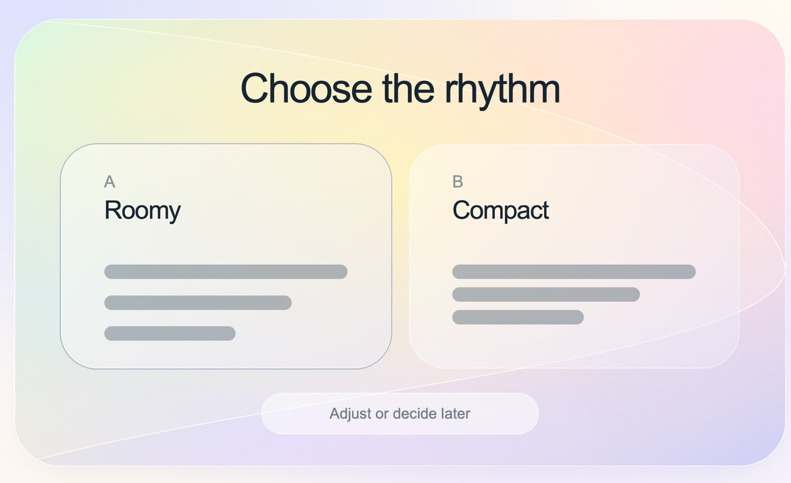
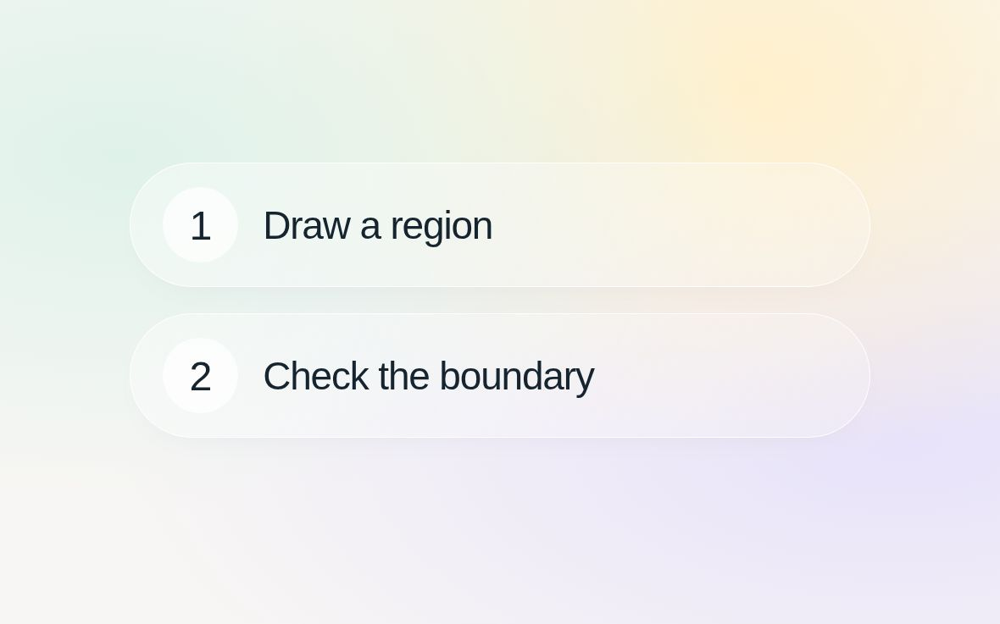
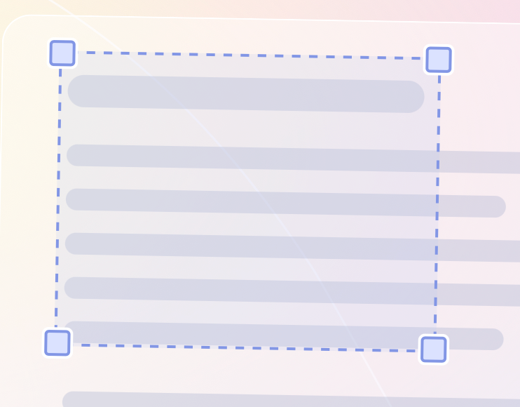

# Translucent UI — a small example system

An approved visual family with bounded component studies and a runnable page example, not a production component library. The selection-preview composition is the primary reference; the choice composition is a second retained example. Start with these complete relationships before borrowing individual tokens.

## Example levels

- **Component relationships:** the selection and choice compositions below establish the visual family.
- **Page-level composition:** [Pastel Workspace](pastel-workspace/README.md) extends it through unequal project density, restrained surfaces, and a focused action area. Includes desktop/narrow screenshots and runnable code.
- **Portable primitive:** the [selection frame](../../references/selection-frame.md) can be examined independently.

## What carries the beauty

Keywords: quiet translucent planes, warm focal field, dark typography, nested scale, purposeful outline.

The broad pastel surface and crisp content work together. Large type has a quiet field around it; the smaller controls remain part of the same material. The selection rectangle expresses the actual task rather than adding a detached ornament.

## Composition

- Selection preview: a compact instruction group on the left balances a larger nested preview on the right. Time, title and steps form one readable sequence.
- Choice preview: equal-sized panels share a heading and aligned content positions. Selection is expressed with a stronger boundary, not an unrelated saturated fill.
- Keep the approved relative scale of the time, instruction pills, preview and control handles. Do not shrink the preview into an icon or spread the text into disconnected corners.
- Match the orientation of content and its supporting plane deliberately. Empty space must separate meaningful groups, not become an unoccupied hole between unrelated elements.

## Foundation roles

- **Canvas:** pale cool lavender, with warmer quiet areas.
- **Expressive surface:** broad mint → cream → peach/pink → lavender transitions; low-frequency color fields, thin white edge, restrained shadow.
- **Primary ink:** dark blue-black, neutral enough to remain stable across the surface.
- **Secondary ink:** quieter cool gray, still readable at actual size.
- **Control surface:** translucent white; let background color remain visible without obscuring labels.
- **Selection accent:** periwinkle outline, pale translucent selection fill, white-separated corner handles.

These are roles, not a universal palette. The CSS companion records implementation starting values, not color measurements reverse-engineered from a generated image.

## Components

### Numbered instruction pill

A broad pill contains a smaller circular number and a dark label. The circle clarifies sequence; it does not compete with the text. Maintain internal breathing room and a consistent vertical center. These rows are instructions in the retained composition, not proven clickable buttons; add button semantics only when a real action exists.

### Selection frame

A reusable visual primitive with an [independent guide](../../references/selection-frame.md). It can be studied separately from this pastel system. Its portability remains a hypothesis until checked on the target background and interaction model.

### Choice panel

Equal surfaces provide a fair comparison. An active outline separates selection from hover and focus; keep adequate inset around text. A choice becoming selected is not evidence of submission or downstream work.

## Reproduction

1. Establish the complete frame, left/right mass and text scale.
2. Place live text and real component geometry in code.
3. Layer broad gradients under the content; keep fine texture absent.
4. Add one restrained surface contour, then the nested previews and controls.
5. Compare with the retained PNG at the same aspect ratio; review edges and auxiliary regions as carefully as the focal content.

See [foundation CSS](tokens.css), the editable [instruction specimen](step-pill.html), and the editable [selection specimen](selection-frame.html). Both component specimens are static visual demonstrations, with complete boundaries and deliberate surrounding space; they do not implement actions or resizing. For the page-level extension, see [Pastel Workspace](pastel-workspace/README.md): a fictional English project overview with live controls, one-question-at-a-time interaction, and a compact local-choice dialog. Its validation boundaries are documented separately.

## Scope and provenance

Retained on 2026-10-15 after explicit visual approval. The two full-page PNGs preserve the selected Web recreation, derived from an earlier GPT Image direction and then implemented with HTML/CSS/SVG. The two component PNGs are newly rendered, deliberately framed HTML/CSS specimens with supportive backgrounds; feedback screenshots served only as references, not as the final component assets. They contain illustrative labels and placeholder content, not live project state.

The whole selection composition, its instruction pills and selection frame were strongly approved. The choice composition was approved as an additional example. Other pages in the exploration are not implicitly approved.

Local Chrome rendering and basic pointer selection were exercised in the working prototype. Cross-browser, mobile, keyboard resizing, screen-reader operation, real App launch, persistent feedback and handoff are not verified by these images. The four corner handles are a visual state, not proof of implemented resizing.

Use as a reference for a bounded task or review interface. Do not apply transparency automatically to dense tables, long-form reading or high-contrast environments. No third-party brand assets are included. Follow repository licensing; no separate license for third-party fonts is granted.

