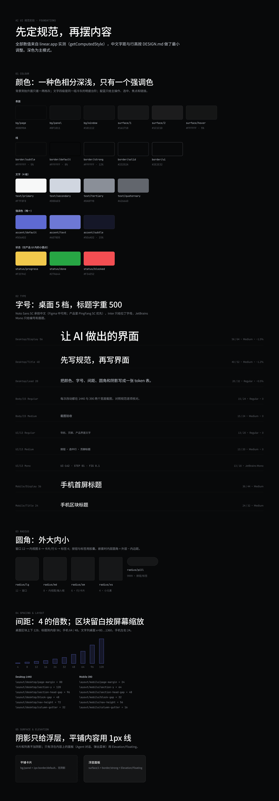
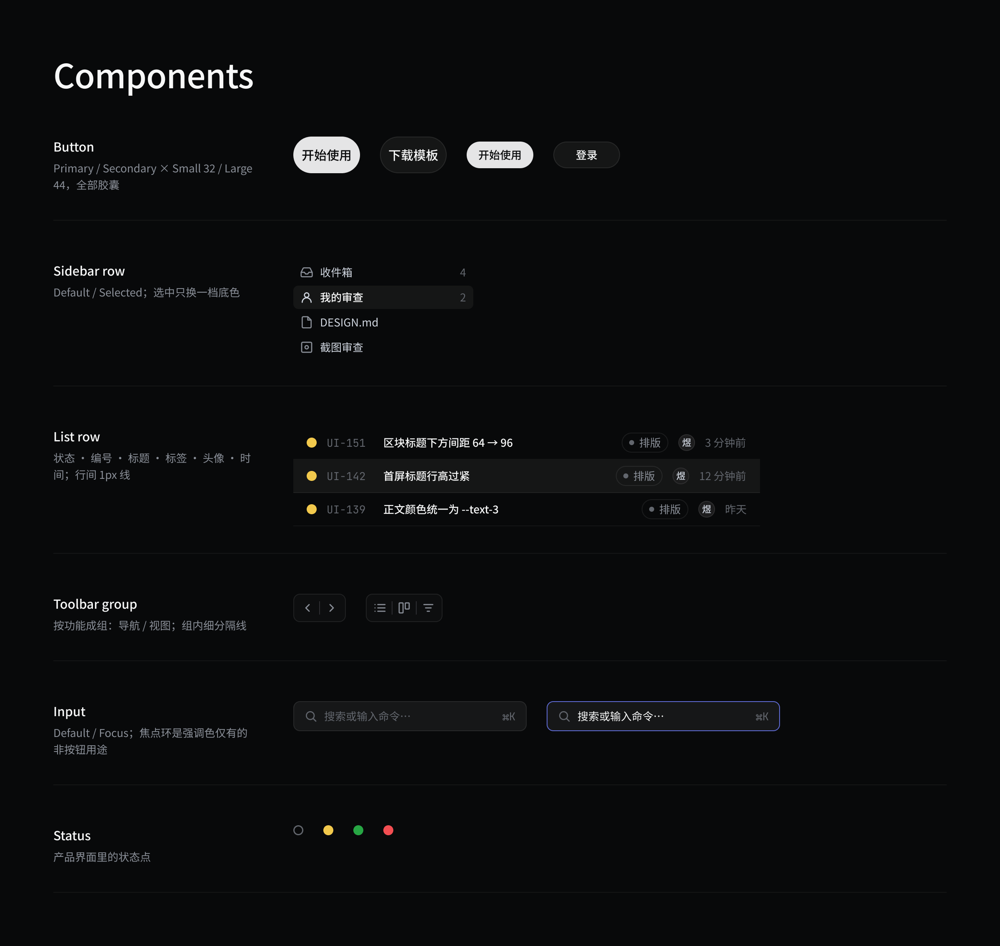
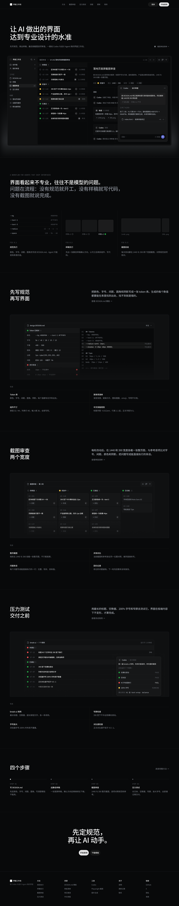

# Linear baseline

A dark Chinese landing page for an AI UI workflow, built as a Figma design system with Foundations, Components and Screens. On 2026-10-20 the user judged it more professional than every earlier example in this repository, and it is the reference result for [METHOD.md](../../METHOD.md).

It is a deliberate study of Linear's visual system, not an original brand. Do not ship this look as your own.

**Figma file:** [AI UI 规范实验 – Linear 基准](https://www.figma.com/design/cytw6jxvr7NDe0K406hGME). Access depends on the owner's sharing settings.

## Where the values come from

- **Colours, type sizes, spacing and shapes** were measured directly from linear.app pages, mainly the [home page](https://linear.app/), [/plan](https://linear.app/plan) and [/build](https://linear.app/build).
- **Title and table-of-contents layout** follow [/method](https://linear.app/method).
- **Window proportions** follow macOS 27 Finder, Mail, the Apple HIG window-anatomy diagrams and Bear.
- Linear's article [Behind the latest design refresh](https://linear.app/now/behind-the-latest-design-refresh) was used only to understand hierarchy and information density. No value comes from it.

Per-value labels and links: [provenance.md](provenance.md). Raw measurements: [research/](research/README.md).

## Figma pages

| Page | Contents | Export |
| --- | --- | --- |
| Foundations | Title and lead, then numbered sections: 01 Colour, 02 Type, 03 Radius, 04 Spacing & layout, 05 Surface & elevation | [foundations.png](figma/foundations.png) (1440 × 4126, 2x) |
| Components | Icons ×18, Status, Avatar, Tag, Button, Sidebar row, List row, Toolbar icon button, Toolbar group, Input, plus an overview sheet | [components.png](figma/components.png) (overview, 2x) |
| Screens | Desktop 1440 × 7263 and mobile 390 × 5771, built from component instances on 12- and 4-column grids | [screen-desktop.png](figma/screen-desktop.png), [screen-mobile.png](figma/screen-mobile.png) (1x) |

| Foundations | Components | Desktop | Mobile |
| --- | --- | --- | --- |
|  |  |  |  |

All images are our own exports from the Figma file (2026-11-01). No Linear or Apple screenshot is included.

## Files

- [tokens.md](tokens.md) and [tokens.json](tokens.json): 77 variables in 5 collections (Primitives 23, Color 25, Radius 5, Spacing 12, Layout 12) with resolved values and aliases, 10 text styles, 2 effect styles, and the component list with sizes. Dumped from the file with figmosha, read-only.
- [DESIGN.md](DESIGN.md): the design contract (thesis, invariants, foundations, validation).
- [rules.md](rules.md): input → method → output → acceptance for each part.
- [provenance.md](provenance.md): sources and what was inherited, adapted and new.
- [research/](research/README.md): the 2026-10-20 measurement notes (Linear study, five-baseline breakdown, macOS values, sources).
- [html/index.html](html/index.html): the same page hand-written in HTML/CSS from the same values, with renders [web-desktop.jpg](html/web-desktop.jpg) and [web-mobile.jpg](html/web-mobile.jpg). It loads fonts from Google Fonts, so it needs network access. It keeps Linear's 64 / 48 display sizes; the Figma file uses 56 / 40 after review.

## Audit and limits

- All 697 solid fills on the two screens are bound to variables. Shadows appear only on floating layers (agent panel, mobile toast) and the primary button.
- Each collection has one mode (the file was on a Starter plan), so desktop and mobile layout values are separate variables. Gradients (hero glow, fades) and the focus ring use raw values.
- Static marketing page only: no interaction, no light theme, no accessibility audit. Product-mock data is fictional. The mobile export is 1x.
